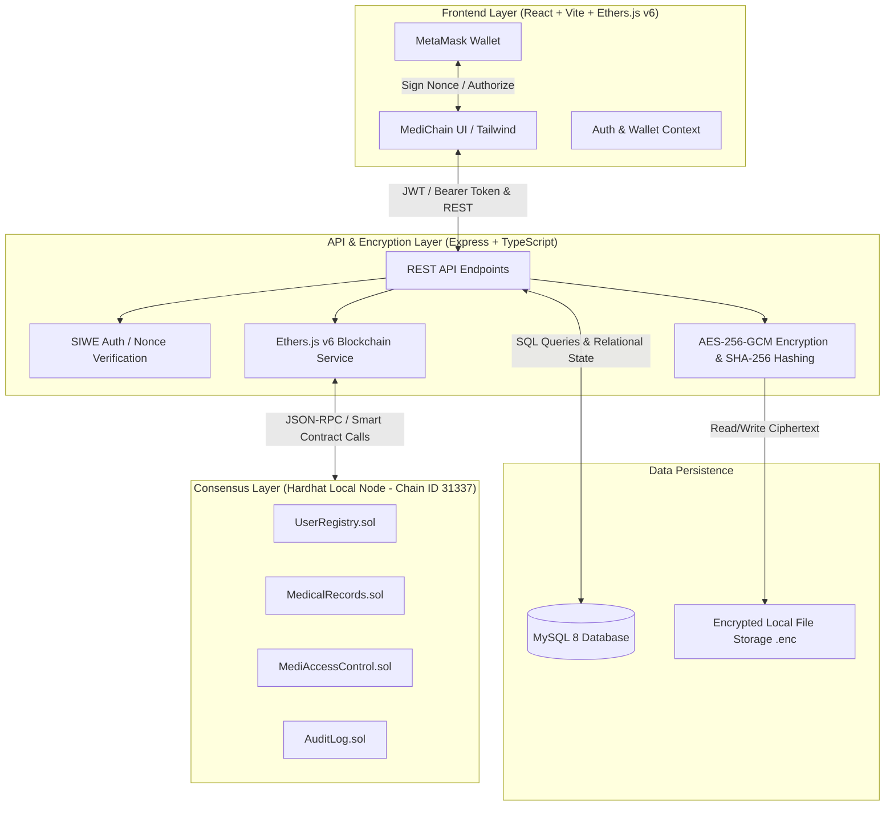

# MediChain — Decentralized Healthcare Records & Patient Consent Management System

[](https://soliditylang.org/)
[](https://hardhat.org/)
[](https://react.dev/)
[](https://www.typescriptlang.org/)
[](https://tailwindcss.com/)
[](https://docs.ethers.org/v6/)
[](LICENSE)

MediChain is a production-grade decentralized healthcare application that solves medical record fragmentation and consent ambiguity. It enforces patient consent on-chain through Ethereum smart contracts while keeping sensitive medical records off-chain, encrypted with **AES-256-GCM**, with SHA-256 integrity digests committed to the blockchain.

---

## 1. Core Architecture & Security Model

> **Fundamental Privacy Rule:** Never store actual patient medical records, diagnoses, prescriptions, names, or identifiable personal information directly on the blockchain.



- **Off-chain AES-256-GCM Encryption**: Every medical report is encrypted before writing to storage. Authenticated GCM tags (16-byte) and IVs (12-byte) prevent ciphertext modification.
- **On-chain SHA-256 Integrity Verification**: SHA-256 cryptographic digests of original documents are registered in `MedicalRecords.sol`. Any alteration produces a mismatch detected instantly as `TAMPERED`.
- **SIWE-style Cryptographic Nonce Authentication**: Users prove wallet ownership by signing a unique server-issued nonce via MetaMask. Possession of an address alone is never trusted.
- **Smart Contract Access Control**: `MediAccessControl.sol` enforces permissions between doctors and patients. A revoked permission on-chain immediately blocks application-mediated document retrieval.
- **Emergency Break-Glass Access**: Authorized physicians can flag urgent clinical scenarios. Every break-glass access event is logged immutably in `AuditLog.sol` and triggers notifications.

---

## 2. Smart Contract Architecture

The blockchain layer consists of 4 modular Solidity `^0.8.24` contracts located in `blockchain/contracts/`:

| Contract | Purpose | Key Functions |
|---|---|---|
| **UserRegistry.sol** | Identity & role registry | `registerUser`, `approveUser`, `suspendUser`, `getRole`, `isApproved` |
| **MedicalRecords.sol** | Document integrity hashes & metadata | `registerRecord`, `getDocumentHash`, `getPatientRecords`, `addVersion` |
| **MediAccessControl.sol** | Patient-controlled consent & permissions | `createRequest`, `approveRequest`, `rejectRequest`, `revokeAccess`, `hasValidAccess` |
| **AuditLog.sol** | Immutable on-chain audit trail | `logEvent`, `getEventCount`, `getAuditEntry`, `setApprovedLogger` |

### Unit Tests
All contracts include comprehensive Mocha/Chai unit tests with **53 passing tests** covering authorization, duplicate rejection, tamper detection, and permission expiry:

```bash
cd blockchain
npx hardhat test
```
```
  UserRegistry
    registerUser: 6 passing
    approveUser: 4 passing
    suspendUser: 3 passing
    isApproved / getRole: 3 passing
  MedicalRecords
    registerRecord: 4 passing
    getDocumentHash & getPatientRecords: 3 passing
    addVersion: 3 passing
  MediAccessControl
    createRequest: 5 passing
    approveRequest: 3 passing
    rejectRequest: 2 passing
    revokeAccess: 3 passing
    hasValidAccess: 4 passing
    getPatientRequests & getDoctorRequests: 1 passing
  AuditLog
    setApprovedLogger: 3 passing
    logEvent: 3 passing
    getEventCount & getEvent: 3 passing

  53 passing (17s)
```

---

## 3. Four User Roles & Portals

### A. Patient Portal
- **Dashboard**: Records count, authorized doctors, pending requests, and category breakdown chart.
- **My Records**: Filterable table of encrypted medical documents with instant download and verification actions.
- **Consent Management**: Review incoming doctor access requests with full clinical reasons; approve with duration (7, 14, 30 days) or reject; revoke permissions at any time.
- **Document Verification**: Independent verification interface comparing current file hash against smart contract record.
- **Audit History**: Transparent chronological activity log of all access requests, consent grants, and revocations.

### B. Doctor Portal
- **Dashboard**: Active patients, pending requests, weekly consultation chart, quick upload shortcut.
- **Find Patients**: Directory search by patient code (`PAT-001`), name, or blood type to submit access requests.
- **Authorized Patients**: List of patients with active smart contract permissions.
- **Upload Record**: Multipart form supporting diagnosis, prescription, lab report, consultation notes, and discharge summaries up to 10MB. Document is encrypted with AES-256-GCM and its hash is committed on-chain.

### C. Hospital Portal
- **Dashboard**: Facility accreditation overview, affiliated physicians, registered patients, and integrity metrics.
- **Manage Doctors**: Directory of hospital physicians with license numbers and verification status.
- **Patients Directory**: Departmental patient list.
- **Hospital Records**: Department-wide clinical archive with verification status.

### D. Administrator Portal
- **Dashboard**: System-wide analytics (total users, patients, doctors, hospitals, records, active consents).
- **Pending Approvals**: Verification interface to approve or reject pending doctor and hospital registrations.
- **User Management**: Comprehensive user table with wallet search, role filters, and account suspension controls.
- **Blockchain Ledger**: Live feed of transactions committed to the Hardhat local node.
- **Security & Audit**: Full audit trail of platform events.

---

## 4. Hardhat Demo Accounts

Use these pre-funded Hardhat test accounts in MetaMask:

| Role | Hardhat Index | Wallet Address | Private Key |
|---|---|---|---|
| **Admin** | Account 0 | `0xf39Fd6e51aad88F6F4ce6aB8827279cffFb92266` | `0xac0974bec39a17e36ba4a6b4d238ff944bacb478cbed5efcae784d7bf4f2ff80` |
| **Patient 1** | Account 1 | `0x70997970C51812dc3A010C7d01b50e0d17dc79C8` | `0x59c6995e998f97a5a0044966f0945389dc9e86dae88c7a8412f4603b6b78690d` |
| **Patient 2** | Account 2 | `0x3C44CdDdB6a900fa2b585dd299e03d12FA4293BC` | `0x5de4111afa1a4b94908f83103eb2f95808421d2797b5b00b01450b7194f1c1e5` |
| **Doctor 1** | Account 3 | `0x90F79bf6EB2c4f870365E785982E1f101E93b906` | `0x7c852118294e51e653712a81e05800f419141751be58f605c371e15141b007a6` |
| **Doctor 2** | Account 4 | `0x15d34AAf54267DB7D7c367839AAf71A00a2C6A65` | `0x47e179ec3427449b222584312a79880694889ab88bfa7de07446078e479e0e1e` |
| **Hospital 1**| Account 5 | `0x9965507D1a55bcC2695C58ba16FB37d819B0A4dc` | `0x8b3a350cf5c34c9194ca85829a2df0ec3153be0318b5e2d336d8520844274025` |

---

## 5. Local Setup & Startup Guide

### Prerequisites
- **Node.js**: v18 or v20+
- **MySQL**: v8.0+ running on port `3306`
- **MetaMask** browser extension

### Step 1: Configure MetaMask for Local Hardhat
1. Open MetaMask &rarr; Networks &rarr; **Add Network Manually**.
2. **Network Name**: `Hardhat Local`
3. **New RPC URL**: `http://127.0.0.1:8545`
4. **Chain ID**: `31337`
5. **Currency Symbol**: `ETH`
6. Click **Save**.
7. Import test accounts using the private keys from Section 4.

### Step 2: Database Setup & Migrations
1. In `backend/.env`, set your MySQL root password:
   ```env
   DB_HOST=localhost
   DB_PORT=3306
   DB_USER=root
   DB_PASSWORD=your_mysql_password
   DB_NAME=medichain
   ```
2. Run database migrations and seed realistic demo data:
   ```bash
   cd database
   node migrate.js
   ```

### Step 3: Automated One-Click Startup (Windows)
Double-click `start-all.bat` or run:
```powershell
.\start-all.ps1
```
This automatically starts:
1. Hardhat node (`8545`)
2. Smart contract deployment
3. Express backend (`5000`)
4. Vite React frontend (`5173`)

### Step 4: Manual Startup (Alternative)
Open 3 terminal windows:

**Terminal 1 (Blockchain Node & Deployment):**
```bash
cd blockchain
npx hardhat node
# In another terminal window:
npx hardhat run scripts/deploy.js --network localhost
```

**Terminal 2 (Backend API):**
```bash
cd backend
npm run dev
```

**Terminal 3 (Frontend App):**
```bash
cd frontend
npm run dev
```

Open **`http://localhost:5173`** in your browser.

---

## 6. End-to-End Workflow Verification Walkthrough

Verify the complete decentralized healthcare workflow:

1. **Patient Registration**:
   - Connect MetaMask with Account 1 (`0x7099...`).
   - Register as a **Patient** with demographic info.
   - Sign in using the cryptographic signature.

2. **Doctor Requests Access**:
   - Switch MetaMask to Account 3 (`0x90F7...`).
   - Log in as **Doctor** (Dr. Sarah Johnson).
   - Navigate to **Find Patients**, locate Patient 1, and click **Request Access**.
   - Fill in clinical purpose and submit. A transaction is broadcast to `MediAccessControl.sol`.

3. **Patient Approves Access**:
   - Switch MetaMask back to Account 1.
   - The notification bell rings. Navigate to **Access Requests** &rarr; **Pending**.
   - Click **Approve Access**. Smart contract transaction confirms consent.

4. **Doctor Uploads Medical Record**:
   - Switch MetaMask to Doctor (Account 3).
   - Go to **Upload Record**, choose Patient 1, select `Diagnosis Report`, attach a test PDF/image, and click **Encrypt & Commit**.
   - Backend performs AES-256-GCM encryption, generates SHA-256 digest, and commits to `MedicalRecords.sol`.

5. **Document Verification**:
   - In either Patient or Doctor portal, click **Verify Hash**.
   - The modal compares decrypted file SHA-256 against on-chain hash and displays **VERIFIED** in green.

6. **Revoke Consent**:
   - In Patient portal, go to **Access Requests** &rarr; **Approved** &rarr; **Revoke Access**.
   - Smart contract updates status to `REVOKED`.
   - The doctor is immediately blocked from viewing or downloading the patient's records.

7. **Audit Review**:
   - Switch MetaMask to Admin (Account 0).
   - View **Security & Audit** and **Blockchain Ledger** to review all on-chain events.

---

## 7. Project Structure

```
Medicore/
├── blockchain/
│   ├── contracts/
│   │   ├── UserRegistry.sol         # Roles & address registry
│   │   ├── MedicalRecords.sol       # Document hashes & versions
│   │   ├── MediAccessControl.sol    # Consent & permission management
│   │   └── AuditLog.sol             # Immutable audit events
│   ├── scripts/
│   │   └── deploy.js                # Deployment script & ABI export
│   ├── test/
│   │   └── contracts.test.js        # 53 comprehensive unit tests
│   ├── hardhat.config.js            # Hardhat network config (Chain ID 31337)
│   └── package.json
├── backend/
│   ├── src/
│   │   ├── config/                  # DB, addresses, ABIs
│   │   ├── middleware/              # JWT auth, RBAC, multer upload
│   │   ├── routes/                  # REST endpoints (records, access, auth, users, admin)
│   │   ├── services/                # AES-256-GCM encryption, blockchain, access, auth
│   │   ├── utils/                   # Hash, logger
│   │   ├── app.ts                   # Express application setup
│   │   └── server.ts                # Server bootstrap
│   ├── uploads/encrypted/           # AES-256-GCM ciphertext storage
│   └── package.json
├── database/
│   ├── migrations/                  # 001 through 008 migration SQL scripts
│   ├── seeds/                       # 001 through 006 realistic demo seeds
│   ├── schema.sql                   # Combined full schema
│   ├── seed.sql                     # Combined seed data
│   └── migrate.js                   # Node migration runner
├── frontend/
│   ├── src/
│   │   ├── components/              # Layout, Cards, Modals, Badges, Charts
│   │   ├── context/                 # WalletContext, AuthContext
│   │   ├── hooks/                   # useWallet, useAuth, useNotifications
│   │   ├── pages/                   # Patient, Doctor, Hospital, Admin portals
│   │   ├── services/                # Axios API clients
│   │   ├── types/                   # TypeScript interfaces
│   │   ├── App.tsx                  # Router with role-based guards
│   │   └── main.tsx
│   ├── tailwind.config.js           # Professional navy & teal design theme
│   └── vite.config.ts
├── docs/
│   ├── ARCHITECTURE.md              # System design & sequence diagrams
│   ├── API_DOCUMENTATION.md         # Full REST API specification
│   └── DATABASE_ERD.md              # Database entity-relationship diagram
├── start-all.bat                    # Windows 1-click batch launcher
├── start-all.ps1                    # Windows PowerShell launcher
├── package.json                     # Root orchestrator scripts
└── README.md
```

---

## 8. Known Limitations & Production Enhancements

- **IPFS / Decentralized Storage**: For local development, files are encrypted and stored in local encrypted file storage (`backend/uploads/encrypted/`). In public blockchain production, encrypted buffers can be pinned to IPFS/Filecoin with CID references stored on-chain.
- **Key Management**: In production, integrate AWS KMS, HashiCorp Vault, or patient-derived Shamir secret shares for master encryption key rotation.
- **Gas Optimization**: When deploying to Ethereum L2s (Arbitrum, Optimism, Polygon), batch access grants using Merkle proofs to reduce gas overhead.

