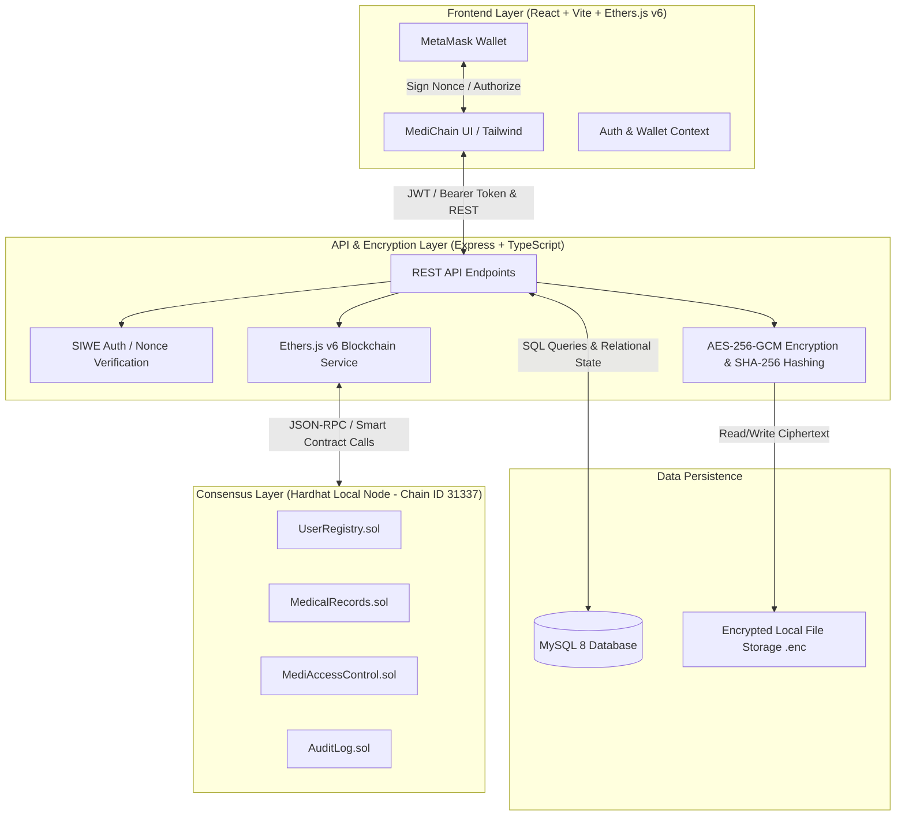
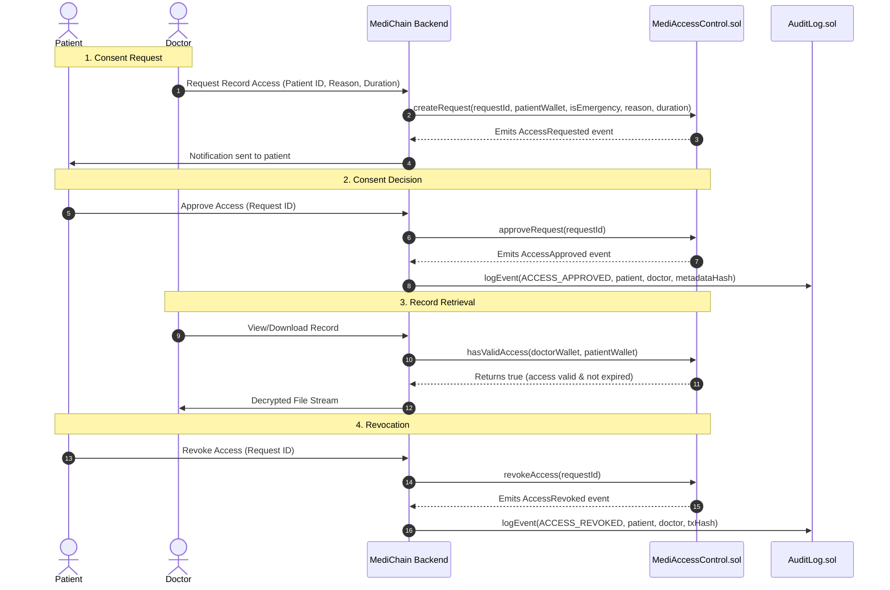

# MediChain — System Architecture Documentation

## 1. High-Level System Architecture

MediChain combines Ethereum smart contracts (local EVM), off-chain AES-256-GCM encrypted document storage, a MySQL relational database for fast querying, and a modern Web3 React frontend.

---

## 2. Privacy & Off-Chain Storage Design

> **Guiding Principle:** NEVER store protected health information (PHI), patient names, diagnosis text, prescriptions, or identifiable data directly on the public or private blockchain ledger.

1. **Document Upload Workflow**:
   - The user (doctor or hospital) uploads a medical document (PDF, PNG, JPG, DOCX).
   - The backend validates the mime-type and file size (limit: 10MB).
   - The backend generates a random 12-byte Initialization Vector (IV).
   - The document buffer is encrypted using **AES-256-GCM** using the backend's master encryption key.
   - The authenticated GCM tag (16 bytes) and IV (12 bytes) are prepended to the ciphertext.
   - The encrypted payload is saved to `./uploads/encrypted/{uuid}.enc`.
   - The **SHA-256 hash** of the original plaintext document is computed.
   - The record identifier (UUID) and SHA-256 hash are registered in `MedicalRecords.sol`.
   - The database stores the record metadata, file hash, and blockchain transaction hash.

2. **Decryption & Verification Workflow**:
   - A doctor or patient requests a document download.
   - The backend checks `MediAccessControl.sol` or database permissions to verify active consent.
   - The encrypted buffer is read from disk.
   - The 12-byte IV and 16-byte tag are extracted and deciphered with AES-256-GCM.
   - If verifying: the SHA-256 digest of the deciphered buffer is computed and strictly compared with the on-chain hash recorded on `MedicalRecords.sol`.
   - If the hashes match, the status is **VERIFIED**; if any byte differed, the status is **TAMPERED**.

---

## 3. Smart Contract Interaction Flow

---

## 4. Emergency Break-Glass Access Workflow

- Authorized emergency doctors can mark an access request with `isEmergency: true`.
- The smart contract records the emergency flag and stores the specific clinical reason.
- Emergency requests are immediately surfaced with prominent visual badges in the patient portal.
- An automatic `EMERGENCY_ACCESS` event is logged to `AuditLog.sol` and the backend audit trail.
- Emergency permissions have shorter default lifetimes (e.g. 24 hours to 7 days).

