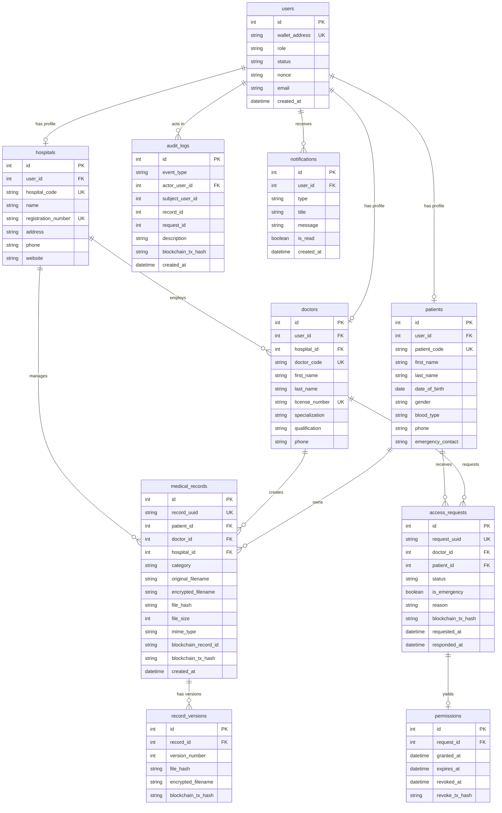

# MediChain — Database Entity-Relationship Diagram (ERD)

The MediChain relational schema uses MySQL 8 with strict foreign key constraints, proper indexing on wallets/hashes/categories, and cascade/restrict deletion rules.

